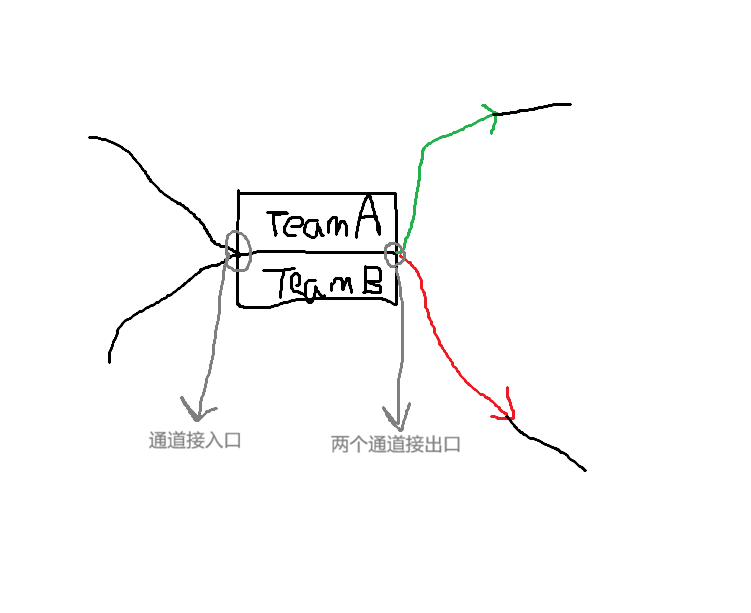

# Graph Linker

## 关于本项目

这是关于 CSEMTV 项目中，任意赛制流程链接器的概念开发分仓库。

## 基本设想

### 文件类型

目前确定为 .csem 后缀文件，设想是软件读取类似文件即可理解图与素材的调用，以及赛制流程细节。

### 赛制流程的编码与编辑，以及任意赛制流程链接器（Graph Linker）的细节

一般来说，赛制流程由如下几个部分组成：单一比赛框，框间链接通道，种子层，起始层，赛果层，以及**阶段**的概念。

#### 框间链接通道

单一比赛框/种子层/赛果层 之间的通信通道，同一根管道一般用于传输单个队伍，但也可以传输空值和临时的双队信息。

#### 单一比赛框

单一比赛框包含两个**对阵位**，一个**通道接入口**，两个**通道接出口**和一个**比赛时序**。同时，比赛前后单一比赛框也有**未定/胜负 展示**和其余**比赛信息**。

- 对阵位：一场比赛必定包含且仅包含比赛双方，两支队伍各占一个对阵位。在本项目的构建中，对阵位按上下排列，先上后下。
- 通道接入口：用于读取从通道传来的队伍。一个通道接入口将接入两个通道，即允许接入两次队伍信息。队伍无先后，单一比赛框通过通道接入口接收的队伍将优先排入上对阵位，若上对阵位已满，则排入下对阵位。
- 通道接出口：用于通过通道发送队伍。一个通道接出口仅接出一个通道，单个通道仅允许且必须接出一次队伍信息。在该单一比赛框对应的比赛结束之后，即通过通道接出口发送两支队伍。两个通道接出口分为胜接出口与败接出口，对阵的胜方通过胜接出口发送至下一个单一比赛框或赛果层，对阵的败方通过败接出口发送至下一个单一比赛框或赛果层。
- 比赛时序：决定了本场比赛的比赛时间，写于右上角，格式为 YYYY-MM-DD #X。其作用和生成方式将于主项目中完善，此处占位即可。
- 其余比赛信息：和比赛时序相同，其生成方式将于主项目中完善，此处无需占位。
- 未定/胜负 展示：指三种不同的对阵位底色，初始为深蓝/正红/淡墨绿 表示胜负未定/败方/胜方，主项目中此处将允许更改，但此项目不需要考虑，但也需要留出接口。

#### 种子层，起始层与赛果层

三个特殊的比赛框，且赛事模拟过程中种子层和起始层均不显示。

- 种子层：包含了**全阶段**的所有比赛战队，按照某个方式排序并按顺序赋予**种子排名**，排序方式同样将在主项目中补齐，但是此处需要留出排序函数的接口，本项目中排序函数使用直接返回函数即可。
- 赛果层：包含了**本阶段**的所有比赛战队，每个战队位置包含一个通道接入口和一个通道接出口。赛果层分为两个区域：
  - 下阶段推送部分：进入本区域的队伍将被赋予**不为零的**的**阶段末排名**（注意，种子层中所有战队初始时的阶段末排名为零），用于下阶段的起始层排序，同时所有队通过每队各一根通道发送至下一阶段的起始层。
  - 结算部分：进入本区域的队伍将获得其在**本赛事**的**最终排名**，同时也将不被通道发送至下一阶段，即战队淘汰。
  - **当且仅当**当前阶段已是最后阶段时，本阶段赛果层的下阶段推送部分大小为零。在赛事模拟的过程中，也可根据当前阶段的下阶段推送部分大小是否为零来判断当前阶段是否为最后阶段。
- 起始层：包含了**本阶段**的所有比赛战队，从种子层和上一阶段的赛果层（第一个阶段起始层所有战队均来自种子层）接受战队直至填满预计的 X 支战队之后，排序并通过通道发送至后续的单一比赛框/赛果层。假设本阶段战队数为 X，则种子层包含 X 个不同的通道接出口，接至赛果层/单一比赛框。排序方式同样将在主项目中补齐，但是此处需要留出排序函数的接口，本项目中排序函数使用直接返回函数即可。同时，对于排序函数，该函数应当由玩家设定，程序提供第一/第二/第三关键字（玩家从种子排名、阶段末排名、**实时积分**排名三项中选择任意项，三个关键字均可空选，此时表示直接返回函数。同时，本项目中所有战队实时积分默认为0）

#### 阶段

完整的赛制流程被允许拆分为多个阶段，类似分p展示的逻辑。

### 图形链接展示

如图，是设想中的单一比赛框蓝图。

注意，图中灰色箭头为注释，其他均为可见内容（从起始层/种子层发出的通道除外）。

### 其他细节

- TBD 填充：若单一比赛框/起始层/赛果层 中的对阵位/战队位值为空值，则显示为TBD。
- 双选预推送：单一比赛框对阵位填满且比赛开始前，向两个胜败发送通道均打包发送两支战队（假设是 A vs B）并附带特殊标记。在单一比赛框/赛果层中，若某一对阵位/战队位仅接收到一个带有特殊标记的信息，则解包该信息并将本对阵位/战队位显示为 ``A/B``。
- 按步推进：在本项目中，按照类拓扑序排序比赛推进的顺序（比赛的胜负随机决定），每次步进只结束一场比赛。每次步进后，立即推送当前比赛的结果，并按顺序判定当前阶段赛果层是否填满、下阶段起始层是否填满，若填满，则立即发送战队并检测是否产生了新的两个对阵位填满的单一比赛框，并加入比赛队列。注意，双选预推送机制推送的包含双队的特殊标记信息显示**不代表**改对阵位已被填充。
- .csem 文件的结构和读取器同样需要设计。由于资源限制，本项目中使用 JavaScript+HTML展示和完善该设想，但是主项目采用C++作为开发语言，需要维护最终态转C++的操作文档。

## 可运行 HTML 原型（2026-10-07）

打开 [index.html](index.html)，或在本目录运行 `python -m http.server 8765 --bind 127.0.0.1` 后访问 `http://127.0.0.1:8765/`。无需安装 npm 依赖。

1. 先用默认 8 队两阶段示例，每次“下一步”只结束一场，观察 A/B 候选、确认结果及跨阶段排序；可退回一步或重置。已确认的比赛进入 FIFO 队列，新就绪比赛追加到队尾；仅同一步同时就绪时按节点顺序破同序，不允许后来就绪的早建节点插队。
2. 点击阶段、比赛、赛果或种子编辑属性；出口再入口建立通道，Shift + 点击可增选/取消多个出口，再一次接入同一个入口。整批校验容量、方向、所属阶段与环路，非法时不写入部分通道。切换阶段保留出口选择，Esc 取消。
3. 创建下一阶段后，上一阶段的全部推送位自动接至新阶段起始层；已有下一阶段时，把赛果位改为推送也会自动接线。原有有效通道不会重复生成；改变为淘汰结算会移除该出口。目标人数不匹配时由校验提示，不静默丢弃晋级队伍。
4. 比赛框固定生成在画布 (423,47)，赛果位固定生成在 (846,47)，不随已有节点数量变化。拖动比赛标题或赛果位吸附 23.5px 网格（赛果位宽度 235px 的 1/10）；连续添加会重叠，选中框置顶后可拖走。Del / Backspace 删除选中对象及附着通道，可撤销；在输入框中仅执行文字编辑。
5. “模拟视图”隐藏种子和起始层。新建空白流程后按需增加阶段、队伍、比赛与赛果，校验通过才能推进。
6. 导入/导出 `.csem` 结构；[sample.csem](sample.csem) 可用于导入。草稿保存在当前浏览器，运行历史不写入赛制文件。载入与导入会同步推送通道，普通布局不重排。

用户已明确：**所有排名只允许升序；第二、第三关键字只用于前项相同时排序；起始层排序后赋予每队唯一排名。** 三项可空选，最终平手按到达顺序稳定排列。

规则测试：`node engine.test.js` 与 `node editor.test.js`，最新实际通过 74 + 32 项断言。[fifo_queue.csem](fifo_queue.csem) 为 FIFO 回归赛制：下游比赛在文件里先创建，但在 A、B 结束后才就绪，正确推进顺序为 A → B → C → D → 下游赛。浏览器已实际验证该顺序、退回恢复及默认八场完赛；此前接线、删除快捷键、固定生成和拖动吸附验证记录见 [OPERATIONS_HANDOFF.md](OPERATIONS_HANDOFF.md)。导出下载落盘等未执行项仍标未验证。固定有向无环图可编辑；动态重配对和条件性重赛尚未实现。文件格式与主项目迁移见 [CPP_MIGRATION.md](CPP_MIGRATION.md)，C++/Godot 集成未验证。
